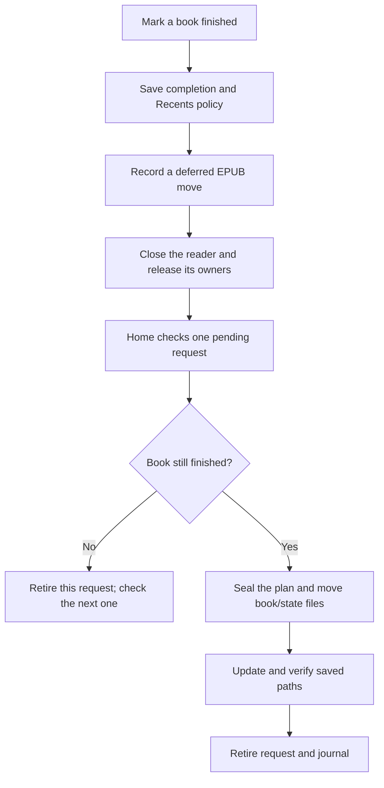

# Finished-book integration

B5 and C6 remain experimental. Marking, the near-end prompt, completion
statistics, Recents policy, and deferred EPUB moves have separate gates. This
stage fixes Home's queue advancement and Retry controls; it does not declare
the whole move workflow ready for installation.

## Current flow

Closed-book controls use the existing immediate transaction path. Open EPUBs
queue their move until the reader is destroyed. Marking a queued book unfinished
lets the checked cancellation path retire its request without moving its files.

## Home queue and Retry

Home makes one entry attempt. A move, cancellation, temporary busy state, or
unavailable storage schedules another attempt after 500 ms. A successful move
reloads Home so covers and Recents use the updated paths. Cancellation now
advances to the next queued book instead of stopping the queue.

The delayed attempt handles one request. A cancellation schedules the next;
an empty queue stops. Busy, unavailable, blocked, or recovery-required results
offer Retry and OK. OK is the default. Retry schedules one new attempt; it
does not clear journals, delete conflicts, or bypass validation. There is no
unlimited automatic retry of a failure. Home's loop stops while another screen
is active, so entering a reader pauses this work.

The firmware change reuses the existing three Home flags, timer, popup, and
executor. It adds no worker, heap buffer, or persistent format. The popup has
two labels instead of one and reuses its existing owned label/callback storage.

## Enabled profile

The first native build with `CROSSPOINT_EXPERIMENTAL_DEFERRED_AUTOMATION=1`
passed in 182.26 seconds. The preceding eight-feature profiles did **not**
enable this executor. The personal `x4pro-completion-automation-wip` profile
extends `x4pro-bars-wip`, adding that ninth flag. It remains an experimental
validation profile, not an installation candidate.

The enabled build uses 113,068 static RAM bytes and 5,761,998 flash bytes.
The final incremental build after adding Busy handling passed in 75.56 seconds
with the same static RAM and flash sizes. Runtime memory, latency, and physical storage behavior remain pending.

## Published-reference recovery

A reference save can publish its new primary and then fail while archiving
the old backup. That state previously blocked every Retry. The move writer now
finishes the archive when the existing primary exactly matches the expected
serialized document, no temporary file remains, and the primary and backup
have eligible, independent chains. The backup stays in numbered move history;
the primary is not rewritten. Sleep-preference writes keep their existing
recovery policy.

The state and Recents owners use this check even when their in-memory path has
already changed or the removed entry is already absent. This covers a retry
after rollback and an unchanged reload of the published primary. A changed
in-memory snapshot, missing/conflicting primary, surviving temporary file, or
unprovable chain identity remains for review. This adds no journal format or
retained buffer; it reuses the existing bounded JSON serialization and archive.

The native state/Recents classes, their JSON codecs, and the production move
writer pass a host storage-model integration check, including path changes,
Recents removal, unrelated metadata, exact backup preservation, unchanged
reloads, and conflicting snapshots. It also passes sanitizers. The full
2,301-test suite passed in 72.08 seconds; after registering that integration
check, 18 affected checks passed in 3.59 seconds.

Both X4 Pro builds passed: standard in 125.21 seconds (113,140 static RAM bytes;
5,668,454 flash bytes), and automatic completion in 108.68 seconds (113,068
static RAM bytes; 5,761,862 flash bytes). The older footprint above records
the preceding queue stage. This remains host/build evidence, not a device result.

## Sleep-state Retry after retirement

A completed transaction retains its journal directory and retirement receipts.
The directory alone therefore cannot block Home's sleep-state Retry. That
operation now uses the existing statistics access gate under the recursive
storage lock, holding it through artifact recovery and the following state
save. Empty and prepared-only journals allow the retry. Active, conflicting,
damaged, or unavailable journals refuse it. State artifacts belonging to a
book move still block sleep recovery independently.

The state owner is the only firmware caller of `recoverSleepPreferences` and
now owns this journal policy; the lower writer retains its artifact and chain
checks. The existing gate temporarily allocates up to three checked 1,642-byte
journal buffers. They are released before recovery parses or serializes state.
It adds no retained buffer, worker, or persistent format. Runtime scan latency
and heap behavior remain unmeasured on the device.

The native state/Recents integration harness now runs with Page Overlay off
and on. The enabled run uses the real access gate with controlled scanner
results, checking every journal outcome, failed lookup/lock/allocation, exact
artifact preservation, successful archive/resave, and move-artifact refusal.
The existing journal suite separately executes actual replay and retirement;
it verifies that ordinary access resumes while the receipts remain. This is
complementary host evidence, not a physical-card or complete coordinator test.
The 206 affected checks passed in 28.87 seconds, and both native harness
configurations passed AddressSanitizer and UndefinedBehaviorSanitizer.
The automatic-completion X4 Pro build passed in 71.48 seconds, using 113,068
static RAM bytes and 5,761,858 flash bytes. The firmware changes are confined
to the Page Overlay gate; the standard-profile build was not repeated.

At device validation, use a backed-up disposable book, finish its completion
transaction, and confirm that a later sleep-state warning's Retry can save
the current preferences while the retired journal remains. Do not create
corrupt state on the reading card to force this case.

## Host evidence and limits

The initial focused run passed 351 checks in 91.13 seconds. After the new queue
case and final Busy handling, five relevant checks passed in parallel in 0.72
seconds. A missing reference-coordinator link in the first test draft was
resolved by keeping this case focused on queue discovery and physical file
moves; coordinator finalization remains explicitly outside its evidence. The
Home, queue, and lifecycle checks include:

- Home entry and delayed cancellation advancement, the 500 ms wait, timer
  wraparound, successful-move refresh, Retry/OK callbacks, and a persistently
  busy result. The enabled Home harness also passes sanitizers.
- The production activity-replacement branch destroys a current or stacked
  reader before Home enters, with the render lock released. Stand-in resources
  test that ordering; this does not prove hardware file-handle behavior.
- The production journal/intent/plan and file-move routines handle two books
  in the host storage model. Cancelling the first leaves it in place; the
  second stays discoverable and its files move. Its request remains recoverable
  until saved-path finalization. This test does not exercise the full reference
  coordinator or a physical FAT card.

Remaining B5 work includes validating the ownership boundaries below, the
complete saved-path finalization/recovery flow, and device checks. C6 still needs its
enabled prompt/save/move integration checked with that flow. File-scan latency
and responsiveness also need measurement before enabling automatic moves for
normal use. Cumulative release review remains required.

For the eventual device check, use disposable EPUB copies on a backed-up card.
Queue two, mark the first unfinished before leaving its reader, and confirm
that it stays put while the second moves once. Reopen the moved book and check
its position, clippings, and bookmarks. Firmware and development artifacts stay
under `/zDev/`; normal completion output follows the `/read` policy.

## Current ownership audit

The November 12 source audit found these owners and exclusion paths. It did
not find an independent plugin or file-transfer worker writing book files.

| Owner | Existing exclusion or cleanup |
| --- | --- |
| Reader, EPUB metadata, section, and clippings | [Activity replacement](../../src/activities/ActivityManager.cpp) calls `onExit`, destroys the current reader, and destroys stacked activities before Home enters. Destruction matters: `EpubReaderActivity::onExit` alone does not release its EPUB object. Reader exit flushes progress and ends statistics before plugin exit events. |
| Library index and cover grid | [Library exit](../../src/activities/library/LibraryListActivity.cpp) closes its index and resets the recent grid. Activity replacement removes retained list owners. |
| Reopen path and Recents in memory | Traced assignments are in boot, reader remember/exit, file-browser rename, library controls, and completion handlers. The coordinator requires the main task and takes a render lock before storage, excluding navigation and render-time remember updates. Persisted completion updates try the store mutex and refuse a conflicting owner. |
| HTTP uploads, browser plugins, and sync publication | [File Transfer](../../src/activities/network/CrossPointWebServerActivity.cpp) serves requests synchronously in its main loop. [Plugin jobs](../../src/network/CrossPointWebServer.h) execute in the browser; firmware stores their bounded queue. Wi-Fi exit calls `silentRestart` on X4 Pro. Its deep-sleep exception leads to sleep, not Home. A browser job cannot keep executing firmware writes after this session ends. |
| Catalog and Calibre sessions | Their exit paths disconnect Wi-Fi and request the same silent restart. Their request handlers do not run in a separate firmware worker. |
| USB raw storage | `ActivityManager::requiresExclusiveStorageLoop` prevents pending activity transitions while the host owns the card. The USB path restarts before returning to ordinary filesystem use. |
| BLE startup | The separate startup task initializes the page-turner radio. The traced BLE implementation does not open book/cache files or mutate the reopen path or Recents. |

The storage mutex serializes filesystem operations; it does not prove that a
different owner has released a long-lived file handle. The host lifecycle test
checks destruction ordering with stand-ins. These source checks still need
cumulative independent review and live handle/lifecycle validation before
automatic moves are enabled for normal use. Plugin event outboxes retain the
historical book paths in their events; they are not live reopen references.

## Coordinator on FAT and exFAT

`StatsCompletionMoveRealStores` now links the production transaction probe,
statistics readers/codecs, tracking policy, session lease, and statistics access
gate. It previously replaced the probe with an always-matching result and the
lease registry with an always-idle result. The native state/Recents owners,
bounded persistence methods, stored-reference guard, planner, mover, retirement,
and patched SdFat implementation remain in the same executable.

Both keep-in-Recents and remove-from-Recents policies now execute through the
coordinator on FAT and exFAT. Checks cover active-reader refusal before journal
creation, an unresolved Recents temporary file, a stored/memory reopen mismatch,
Retry, exact destination paths, unrelated book metadata, cover-cache references,
sleep preferences, journal/request retirement, and verification after remount.
The enhanced check passed in 34.65 seconds; the unchanged stub-profile journal
check passed in 28.15 seconds. Initial host-adapter and fixture compile failures
were corrected before that pass. No firmware inputs changed in this stage.

The harness still uses a single-threaded storage lock, main-task/render stand-ins,
and an always-stable mutation snapshot. It exercises the real transaction probe
and lease rules, but does not prove simultaneous-task exclusion or live handle
release. Archive discovery uses its existing stand-in. Semantic reopening of
moved native JSON bookmarks and clippings remains a separate check; progress
and CrossInk binary bookmarks are covered below.

The full AddressSanitizer/UndefinedBehaviorSanitizer attempt failed on vendor
SdFat reports: unaligned accesses in `common/FsStructs.h`, null-pointer arithmetic
in `FatLib/FatFile.cpp`, and signed overflow in `ExFatLib/ExFatName.cpp`.
All three categories also reproduce in the older stub-profile journal test.
These findings are retained for handoff triage. No sanitizer category is disabled
and no driver patch is added by this stage. The AddressSanitizer-only run passed;
it is not a full sanitizer pass. Logs are `/tmp/x4-full-move-stores-final.log`,
`/tmp/x4-full-move-stores-asan.log`, `/tmp/x4-full-move-stores-sanitizers.log`,
and `/tmp/x4-move-stub-baseline-ubsan.log`.

## Moved progress and CrossInk bookmarks

The planner now refuses `.bookmark-edit.bak` and `.bookmark-edit.guard` beside
source or destination bookmark keys, for both CRC and native hash names. It
previously checked only older `.tmp`/`.bak` recovery files. With a missing
canonical file, the reader could recover entries from an edit backup while the
planner treated that source as absent. A move then left those entries behind.
A conflict now keeps the book and artifacts in place. Failed artifact lookups
also refuse the plan. Existing Retry/OK controls keep that failure visible.

Normal binary bookmark moves now reopen through the production
`CrossInkBookmarks` loader after FAT/exFAT remount. Versions 2–5 cover both key
schemes, destination-path rewriting, chapter/snippet text, spine, fractional
progress, paragraph anchors, duplicate entries, and recovery flags. The fixture
also loads a recovery-only source, confirms planning refuses it without moving
the book, restores it, and completes the move. Planner checks cover both new
suffixes at both ends and unreadable lookups.

The same fixture executes the EPUB reader's actual progress-load block with
its cache-path provider replaced. It covers supported 4-, 6-, and 10-byte files,
native caches, and legacy CrossInk cache migration to the native destination.
Assertions check spine, page, page count, and optional visible-text offset after
move and remount. This proves persisted loader state; rendered pagination and
physical-device resume remain untested.

The planner reuses its existing path strings, lock, and plan format. It adds no
task or retained buffer. Its enabled X4 Pro frame is 592 bytes in the ELF;
device stack high-water remains unmeasured. Standard and automatic-completion
builds passed in 67.41 and 67.71 seconds. Standard size remains 113,140 static
RAM bytes and 5,668,454 flash bytes; enabled size is 113,068 RAM bytes and
5,761,870 flash bytes.

The 96 affected checks passed in 35.34 seconds. After extending the progress
fixture, the final native reader check passed in 36.10 seconds, and
AddressSanitizer passed. The preceding vendor UBSan findings remain open.
Native JSON bookmark and clipping loaders, remaining recovery phases,
cumulative review, and device validation still prevent a release-readiness claim.
