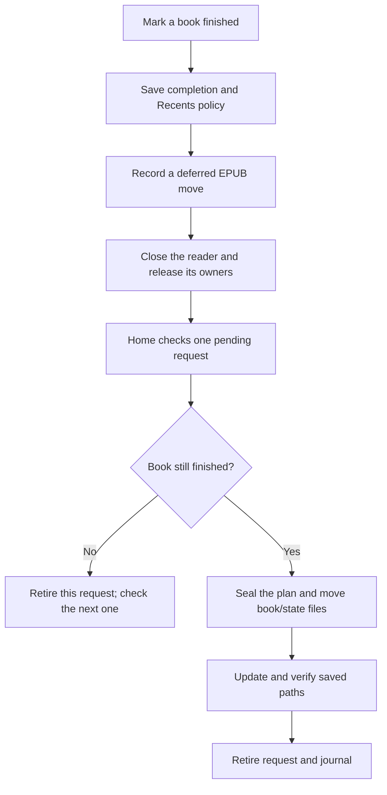

# Finished-book integration

B5 and C6 remain experimental. Marking, the near-end prompt, completion
statistics, Recents policy, and deferred EPUB moves have separate gates. This
stage fixes Home's queue advancement and Retry controls; it does not declare
the whole move workflow ready for installation.

## Current flow

Closed-book controls use the existing immediate transaction path. Open EPUBs
queue their move until the reader is destroyed. Marking a queued book unfinished
lets the checked cancellation path retire its request without moving its files.

## Home queue and Retry

Home makes one entry attempt. A move, cancellation, temporary busy state, or
unavailable storage schedules another attempt after 500 ms. A successful move
reloads Home so covers and Recents use the updated paths. Cancellation now
advances to the next queued book instead of stopping the queue.

The delayed attempt handles one request. A cancellation schedules the next;
an empty queue stops. Busy, unavailable, blocked, or recovery-required results
offer Retry and OK. OK is the default. Retry schedules one new attempt; it
does not clear journals, delete conflicts, or bypass validation. There is no
unlimited automatic retry of a failure. Home's loop stops while another screen
is active, so entering a reader pauses this work.

The firmware change reuses the existing three Home flags, timer, popup, and
executor. It adds no worker, heap buffer, or persistent format. The popup has
two labels instead of one and reuses its existing owned label/callback storage.

## Enabled profile

The first native build with `CROSSPOINT_EXPERIMENTAL_DEFERRED_AUTOMATION=1`
passed in 182.26 seconds. The preceding eight-feature profiles did **not**
enable this executor. The personal `x4pro-completion-automation-wip` profile
extends `x4pro-bars-wip`, adding that ninth flag. It remains an experimental
validation profile, not an installation candidate.

The enabled build uses 113,068 static RAM bytes and 5,761,998 flash bytes.
The final incremental build after adding Busy handling passed in 75.56 seconds
with the same static RAM and flash sizes. Runtime memory, latency, and physical storage behavior remain pending.

## Published-reference recovery

A reference save can publish its new primary and then fail while archiving
the old backup. That state previously blocked every Retry. The move writer now
finishes the archive when the existing primary exactly matches the expected
serialized document, no temporary file remains, and the primary and backup
have eligible, independent chains. The backup stays in numbered move history;
the primary is not rewritten. Sleep-preference writes keep their existing
recovery policy.

The state and Recents owners use this check even when their in-memory path has
already changed or the removed entry is already absent. This covers a retry
after rollback and an unchanged reload of the published primary. A changed
in-memory snapshot, missing/conflicting primary, surviving temporary file, or
unprovable chain identity remains for review. This adds no journal format or
retained buffer; it reuses the existing bounded JSON serialization and archive.

The native state/Recents classes, their JSON codecs, and the production move
writer pass a host storage-model integration check, including path changes,
Recents removal, unrelated metadata, exact backup preservation, unchanged
reloads, and conflicting snapshots. It also passes sanitizers. The full
2,301-test suite passed in 72.08 seconds; after registering that integration
check, 18 affected checks passed in 3.59 seconds.

Both X4 Pro builds passed: standard in 125.21 seconds (113,140 static RAM bytes;
5,668,454 flash bytes), and automatic completion in 108.68 seconds (113,068
static RAM bytes; 5,761,862 flash bytes). The older footprint above records
the preceding queue stage. This remains host/build evidence, not a device result.

## Host evidence and limits

The initial focused run passed 351 checks in 91.13 seconds. After the new queue
case and final Busy handling, five relevant checks passed in parallel in 0.72
seconds. A missing reference-coordinator link in the first test draft was
resolved by keeping this case focused on queue discovery and physical file
moves; coordinator finalization remains explicitly outside its evidence. The
Home, queue, and lifecycle checks include:

- Home entry and delayed cancellation advancement, the 500 ms wait, timer
  wraparound, successful-move refresh, Retry/OK callbacks, and a persistently
  busy result. The enabled Home harness also passes sanitizers.
- The production activity-replacement branch destroys a current or stacked
  reader before Home enters, with the render lock released. Stand-in resources
  test that ordering; this does not prove hardware file-handle behavior.
- The production journal/intent/plan and file-move routines handle two books
  in the host storage model. Cancelling the first leaves it in place; the
  second stays discoverable and its files move. Its request remains recoverable
  until saved-path finalization. This test does not exercise the full reference
  coordinator or a physical FAT card.

Remaining B5 work includes coordination with other writers, the complete
saved-path finalization/recovery flow, and device checks. C6 still needs its
enabled prompt/save/move integration checked with that flow. File-scan latency
and responsiveness also need measurement before enabling automatic moves for
normal use. Cumulative release review remains required.

For the eventual device check, use disposable EPUB copies on a backed-up card.
Queue two, mark the first unfinished before leaving its reader, and confirm
that it stays put while the second moves once. Reopen the moved book and check
its position, clippings, and bookmarks. Firmware and development artifacts stay
under `/zDev/`; normal completion output follows the `/read` policy.
